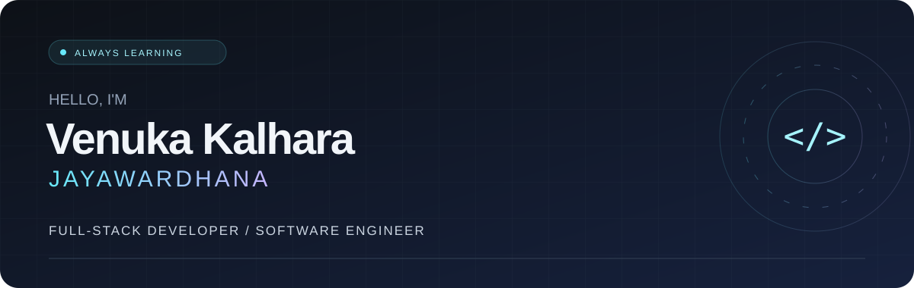

<div align="center">



**SLIIT Undergraduate · Aspiring Software Developer · Software Testing Enthusiast**

Building useful experiences. Asking better questions. Testing the details.

[](https://github.com/venukakalhara?tab=repositories)
[](https://github.com/venukakalhara)

[About](#about-me) · [Toolkit](#my-toolkit) · [Projects](#selected-work) · [Activity](#github-activity)

</div>

## About me

I'm **Venuka Kalhara Jayawardhana**, an undergraduate at **SLIIT** exploring software development and quality engineering. I enjoy turning ideas into practical digital experiences and understanding what makes them reliable.

- **Building** my foundations in programming and web development.
- **Exploring** manual testing, test automation, and Playwright.
- **Practicing** functional and usability testing through projects.
- **Open to** collaboration, shared learning, and new opportunities.

```javascript
const venuka = {
  focus: ["Web development", "Software quality", "Automation"],
  approach: "Stay curious. Build with purpose. Test with care.",
  nextStep: "Turn what I learn into something useful",
};
```


## My toolkit

<div align="center">

**LANGUAGES & WEB**


**TESTING & WORKFLOW**


Tools I'm learning and using as I build my development practice.

</div>

## Selected work

| Project | What it's about | Focus |
| :--- | :--- | :--- |
| **[Full Playwright Project — ITPM](https://github.com/venukakalhara/Full-Playwright-project-ITPM)** | Practical software testing through Playwright automation. | `Playwright` `Automation` |
| **[ITPM Assignment 1 — Option 2](https://github.com/venukakalhara/IT23864306_ITPM_Assignment1_Option2)** | Functional and usability testing of PixelsSuite with manual test cases and automation. | `Manual testing` `Usability` |
| **[ITPM Assignment 1](https://github.com/venukakalhara/ITPM-Assignment-1-IT23864306)** | Hands-on testing work using Playwright-based practices. | `Testing` `Playwright` |
| **[Smart Campus Operations Hub](https://github.com/Janith854/Smart-Campus-Operations-Hub)** | A full-stack platform for university communication, events, and administrative operations. | `Full stack` `Campus operations` |

<div align="center">

**[Explore more repositories →](https://github.com/venukakalhara?tab=repositories)**

</div>


## How I'm growing

| Build | Test | Improve |
| :--- | :--- | :--- |
| Strengthen programming fundamentals and create practical web experiences. | Explore functional checks, usability, and repeatable automation. | Learn through projects, clear communication, and collaboration. |

## GitHub activity

<div align="center">


<details>
<summary>Explore language activity</summary>
<br />

<p><sub>Language activity reflects repository code, not proficiency. Live cards depend on an external service.</sub></p>
</details>

</div>

## Let's connect

Happy to meet fellow developers, testers, and curious learners. Explore my work or connect with me on **[GitHub](https://github.com/venukakalhara)**.

<div align="center">


**Learn continuously. Build intentionally. Test thoughtfully.**

<sub>Thanks for stopping by — see you in the next commit.</sub>

</div>
